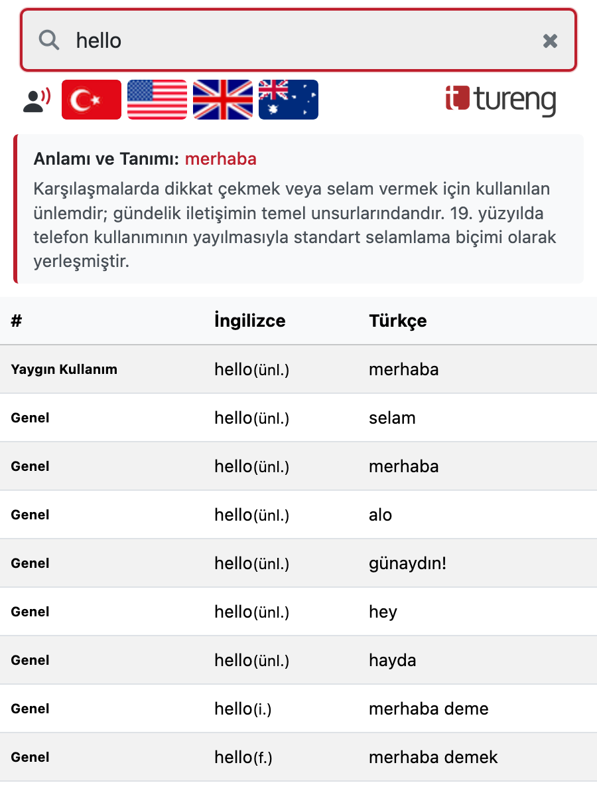
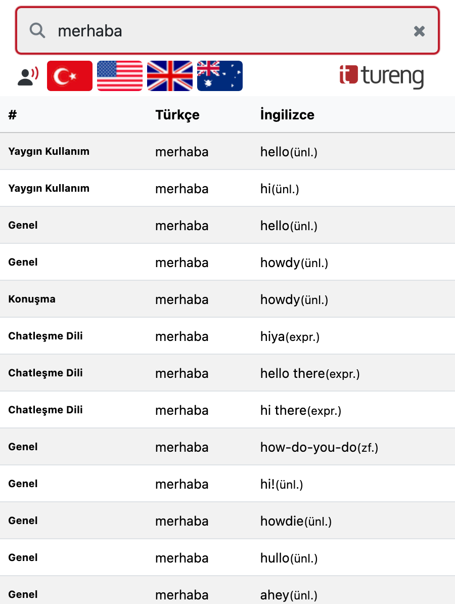
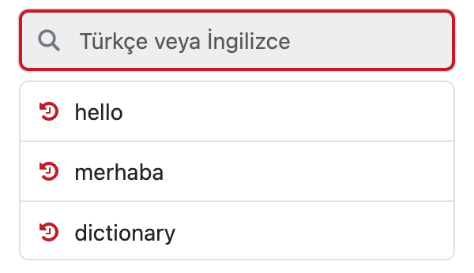

<div align="center">
  

  # Tureng Quick Dictionary & Pronunciation
  ### Tureng Hızlı Sözlük & Çeviri

  <p>
    <strong>Search Turkish–English words with Tureng, listen to multi-accent pronunciations, and view search history without leaving your tab.</strong><br />
    <em>Sayfanızdan ayrılmadan Tureng ile Türkçe–İngilizce kelime çevirisi yapın, okunuşları dinleyin ve arama geçmişinize ulaşın.</em>
  </p>

  <p>
    <a href="https://addons.mozilla.org/firefox/addon/tureng-quick-dictionary/">
      
    </a>
    <a href="https://github.com/ILIMANN/Tureng-Firefox/releases/latest">
      
    </a>
    <a href="https://github.com/ILIMANN/Tureng-Firefox/blob/main/Tureng/manifest.json">
      
    </a>
    <a href="https://spdx.org/licenses/MIT.html">
      
    </a>
  </p>

  <p>
    <a href="#-installation--kurulum">Installation / Kurulum</a> •
    <a href="#-screenshots--ekran-görüntüleri">Screenshots</a> •
    <a href="#-english">English</a> •
    <a href="#-türkçe">Türkçe</a> •
    <a href="#-build-from-source">Build</a>
  </p>
</div>

---

## 📸 Screenshots / Ekran Görüntüleri

<div align="center">
  <table>
    <tr>
      <td align="center" width="38%">
        <strong>English → Turkish & Summary</strong><br /><br />
        
      </td>
      <td align="center" width="38%">
        <strong>Turkish → English</strong><br /><br />
        
      </td>
      <td align="center" width="24%" valign="top">
        <strong>Local Search History</strong><br /><br />
        
      </td>
    </tr>
  </table>
</div>

---

## 🚀 Installation / Kurulum

### 🦊 Firefox (Official Add-on Store)

Install directly with one click from Mozilla Add-ons (AMO):

👉 **[Get Tureng Quick Dictionary & Pronunciation on Firefox Add-ons](https://addons.mozilla.org/firefox/addon/tureng-quick-dictionary/)**

---

### 🌐 Google Chrome / Chromium (Manual Install via GitHub Releases)

> [!NOTE]
> Chrome does not allow one-click installation from outside the Chrome Web Store unless **Developer Mode** is enabled.

**English:**
1. Download **[`tureng-chrome.zip`](https://github.com/ILIMANN/Tureng-Firefox/releases/latest/download/tureng-chrome.zip)** from the [latest GitHub Release](https://github.com/ILIMANN/Tureng-Firefox/releases/latest) and **unzip** it to a folder on your computer.
2. Open Chrome and go to `chrome://extensions`.
3. Enable **Developer mode** using the toggle in the top-right corner.
4. Click **Load unpacked** (top-left) and select the unzipped folder.

**Türkçe:**
1. [GitHub Releases](https://github.com/ILIMANN/Tureng-Firefox/releases/latest) sayfasından **[`tureng-chrome.zip`](https://github.com/ILIMANN/Tureng-Firefox/releases/latest/download/tureng-chrome.zip)** dosyasını indirin ve bilgisayarınızda bir klasöre **çıkartın (unzip)**.
2. Chrome tarayıcınızda adres çubuğuna `chrome://extensions` yazıp açın.
3. Sağ üst köşedeki **Geliştirici modu (Developer mode)** anahtarını etkinleştirin.
4. Sol üstteki **Paketlenmemiş öğe yükle (Load unpacked)** butonuna tıklayın ve çıkarttığınız klasörü seçin.

---

## 🇬🇧 English

**Look up Turkish–English definitions and listen to pronunciations without leaving your tab!**

**Tureng Dictionary** is a lightweight, clean, and fast dictionary extension that brings Tureng's comprehensive Turkish–English dictionary directly into your browser workflow.

### ✨ Key Features
- **Instant Popup Search:** Open a clean popup interface via the toolbar icon or keyboard shortcut without interrupting your browsing.
- **Quick Selection Lookup:** Highlight any word on any webpage and press the shortcut (or click the toolbar icon) to translate it immediately.
- **Context Menu Integration:** Right-click any highlighted word and select **Tureng** to open full results on [Tureng.com](https://tureng.com).
- **Audio Pronunciation (TTS):** Listen to native pronunciations in **Turkish** 🇹🇷, **US English** 🇺🇸, **UK English** 🇬🇧, and **Australian English** 🇦🇺.
- **Local Search History:** Easily revisit your recently searched terms directly from the popup when the search bar is empty.

### ⌨️ Default Keyboard Shortcuts
- **Windows / Linux:** `Alt + Z`
- **macOS:** `Option + Z`

*(You can customize this anytime via `chrome://extensions/shortcuts` in Chrome or `about:addons` → ⚙️ **Manage Extension Shortcuts** in Firefox.)*

### 🔒 Privacy & Permissions
- **No tracking or telemetry:** No personal data is tracked, stored remotely, or shared with third parties.
- **Local-only history:** Your search history stays strictly inside your browser's local storage (`localStorage`).
- **Host permissions:** Only communicates with `https://tureng.com` to fetch translation tables and `https://translate.google.com` to play audio pronunciations when a flag is clicked. See [`policies/privacy-eng.txt`](policies/privacy-eng.txt) for full details.

---

## 🇹🇷 Türkçe

**Sayfanızdan ayrılmadan kelime anlamına bakın, telaffuzunu dinleyin!**

**Tureng Dictionary**, web sayfalarında gezinirken Türkçe–İngilizce ve İngilizce–Türkçe kelime anlamlarına anında ulaşmanızı sağlayan hızlı ve sade bir sözlük eklentisidir.

### ✨ Öne Çıkan Özellikler
- **Hızlı Arama Penceresi:** Açık olan sekmenizi kapatmadan sağ üstteki Tureng ikonu veya kısayol tuşu ile sözlüğü anında açın.
- **Seçili Metni Çevirme:** Web sayfasında bir kelimeyi seçip eklenti ikonuna tıkladığınızda ya da kısayol tuşuna bastığınızda kelime otomatik olarak aranır.
- **Sağ Tık (Bağlam) Menüsü:** Bir kelimeyi seçip sağ tıklayarak doğrudan [Tureng.com](https://tureng.com) üzerinde arama yapın.
- **Sesli Telaffuz (TTS):** Kelimelerin **Türkçe** 🇹🇷, **Amerikan (US)** 🇺🇸, **İngiliz (UK)** 🇬🇧 ve **Avustralya (AU)** 🇦🇺 aksanlarındaki okunuşlarını tek tıkla dinleyin.
- **Arama Geçmişi:** Son arattığınız kelimeleri yerel geçmişte listeleyin ve tek tıkla tekrar görüntüleyin.

### ⌨️ Klavye Kısayolu
- **Windows / Linux:** `Alt + Z`
- **macOS:** `Option + Z`

*(Kısayolu Chrome'da `chrome://extensions/shortcuts`, Firefox'ta `about:addons` → ⚙️ **Eklenti Kısayollarını Yönet** sayfasından dilediğiniz gibi özelleştirebilirsiniz.)*

### 🔒 Gizlilik ve Veri Güvenliği
- Kişisel verileriniz hiçbir şekilde toplanmaz veya üçüncü taraflarla paylaşılmaz.
- Arama geçmişiniz yalnızca tarayıcınızın yerel depolama alanında (`localStorage`) saklanır.

---

## 🛠️ Build from Source

To generate both browser packages (`tureng-chrome.zip` and `tureng-firefox.zip`) from the `Tureng/` source directory:

```bash
node build.js
```

This script packages the extension with browser-specific Manifest V3 configurations (`service_worker` for Chrome, background `scripts` + `browser_specific_settings.gecko` for Firefox).

---

## 👥 Credits & Disclaimer

- **Original Author:** [Kerim Demirel](https://twitter.com/krmdmrl)
- **Contributor:** [Ali Emre Karatopuk](https://www.linkedin.com/in/emrekaratopuk/)
- **Maintainer:** [Mehmet Efe İliman](https://www.linkedin.com/in/efeiliman/)

> **Disclaimer / Yasal Uyarı:** This is an independent, open-source project and is not officially affiliated with or endorsed by Tureng. Translation data is provided via [Tureng.com](https://tureng.com). / Bu eklenti açık kaynaklı ve bağımsız bir geliştirme olup resmi Tureng şirketi ile doğrudan bir bağı bulunmamaktadır. Çeviri verileri [Tureng.com](https://tureng.com) üzerinden sağlanmaktadır.
